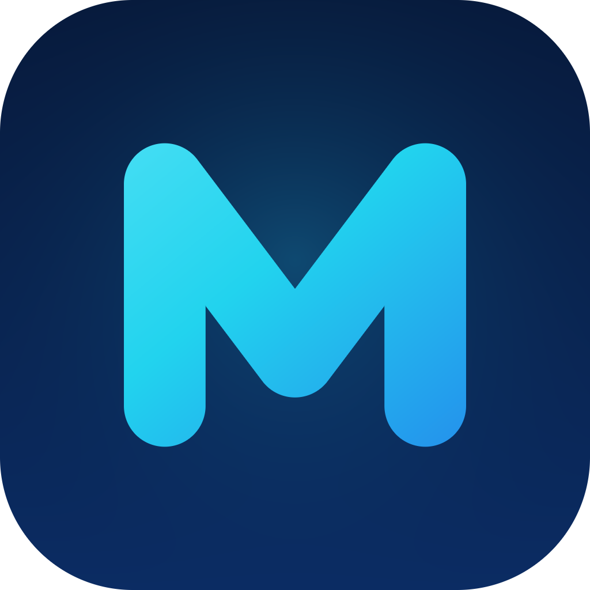

<div align="center">



# Myusic

**A refined YouTube Music client for Android, Android TV and Wear OS.**

<br/>

[](https://github.com/latiefahmad/Myusic/releases)
[](https://github.com/latiefahmad/Myusic/blob/main/LICENSE)
[](https://github.com/latiefahmad/Myusic/releases)
[](https://github.com/latiefahmad/Myusic/releases)

<br/>

[**Download**](#download) · [**Features**](#features) · [**Build**](#build) · [**Contributing**](#contributing) · [**Support**](#support)

</div>

> [!IMPORTANT]
> Myusic is an independent, community-built client. It is not affiliated with, endorsed by, or connected to Google, YouTube or YouTube Music. Use it at your own discretion.

---

<div align="center">


</div>

---

<div align="center">

## Features

<table>
  <tr>
    <td width="50%" valign="top" align="left">

#### Playback
- **Search, browse and play** anything available on YouTube Music.
- **Hi-Res lossless audio** — FLAC/ALAC from a configured module source, with YouTube Music as fallback.
- **Gapless playback with true crossfade**, adjustable 0–12s.
- **Automix [Beta]** — DJ-style transitions with beat-matching and tempo-stretching.
- **Offline downloads** — save tracks with embedded metadata.
- **Local music library** integration.
- **Background playback** via a proper foreground media session.
- **Apple-like lyrics animation** — credit to [binimum](https://github.com/binimum/am-lyrics).

#### Library & Accounts
- **Sign in with your Google account** for personalized content.
- **Spotify integration** — connect your account to play your playlists and Liked Songs.
- **Listen Together** — host or join a listening party with friends.
- **Discord Rich Presence** — in-app login, live track/artist/album and progress.
- **Scrobbling** to Last.fm and ListenBrainz.
- **Pluggable sources** — add, edit, test and health-check module sources.

    </td>
    <td width="50%" valign="top" align="left">

#### Experience
- **Animated album canvas** — motion artwork on the now-playing screen.
- **Word-synced lyrics** — word/syllable-level highlighting from multiple sources.
- **Replay** — your listening year, turned into posters worth sharing.
- **Dynamic, artwork-driven theming** — a Material palette extracted from album art.
- **Frosted-glass UI** — Telegram-style translucent bars via Haze, Material 3 theming.
- **Android TV and Wear OS** — the same library on the big screen and on your wrist.

#### Audio & Controls
- **Per-network audio quality** — separate quality ceilings for Wi-Fi and mobile data.
- **Playback speed control** (0.5×–2.0×) and **skip silence**.
- **Sleep timer** — fixed presets or "stop after this track".
- **System equalizer** integration.
- **Bit-perfect USB exclusive output** — sends lossless tracks to a USB DAC unchanged, at each track's own rate and bit depth. Thanks to [Mornye](https://github.com/mornyeapp/Mornye) for the reference.
- **Stats for nerds** — codec, bit depth, sample rate, and more on the now-playing screen.

    </td>
  </tr>
</table>

</div>

---

<div align="center">

## Download

<a href="https://github.com/latiefahmad/Myusic/releases/latest" target="_blank" rel="noopener noreferrer"></a>

Grab the latest signed APK from the [Releases](https://github.com/latiefahmad/Myusic/releases) page.

</div>

Myusic runs on **Android 8.0 (API 26)** and newer on phones, tablets and Android TV, and on **Wear OS 3 (API 30)** and newer on watches. Sideloading requires enabling "Install unknown apps" for whichever app you download it with. The app checks GitHub Releases for updates, so a newer build installs straight over the old one.

The same release carries the desktop app: an MSI or portable ZIP for **Windows**, an AppImage or DEB/RPM for **Linux**, and a DMG for **macOS** (Apple Silicon and Intel). Tablets get a navigation rail down the leading edge instead of the phone's bottom bar, and the desktop keeps the same player, queue and lyrics as the phone.

| Platform | Installer |
|---|---|
| Windows 10/11 x64 | `Myusic-<version>-windows-x64-setup.exe` or the portable ZIP |
| Linux x86_64 | `.AppImage`, `.deb` or `.rpm` |
| macOS 13+ | `Myusic-<version>-macos-arm64.dmg` or `-macos-x64.dmg` |
| iPhone / iPad | Ad Hoc or AltStore build with your own signing certificate |

macOS builds are unsigned unless a Developer ID is configured: right-click the app and choose Open the first time, or run `xattr -cr /Applications/Myusic.app`.

---

<div align="center">

## Build

</div>

You need **JDK 21** (Android also builds on 17), **Android SDK 37** and the **NDK/CMake** toolchain used by the native audio components.

```bash
./gradlew assembleDevDebug          # Android APK
./gradlew :desktopApp:run           # desktop, from the host
./gradlew :desktopApp:packageDistributionForCurrentOS   # MSI/DMG/DEB for this host
```

On Windows use `.\gradlew.bat` instead. Run the unit tests with `./gradlew testDevDebugUnitTest`.

The iPhone and iPad app is built from `ios/` in Xcode, not Gradle:

```bash
cd ios
open Myusic.xcworkspace
```

It targets iOS 17 and newer and builds for iPhone and iPad. Choose your team under Signing & Capabilities, or build unsigned for a simulator. The app is not on the App Store, so install it with AltStore, SideStore, an Ad Hoc profile or TestFlight.

The desktop needs a C++ compiler and CMake for its Automix analyser and Windows media controls. Gradle detects them: without them the app still builds and runs, but Automix is disabled and Windows falls back to Compose's own window frame. On Windows install MSYS2/MinGW and Ninja; on macOS and Linux the system `clang++`/`g++` and CMake are enough.

| Module | What lives there |
|---|---|
| `app/` | Android phone app, playback service, native audio |
| `tv/` | Android TV UI |
| `wearos/` | Wear OS app |
| `shared/` | Data, streaming, scrobbling, addons |
| `sharedUi/` | Compose UI shared by Android and the desktop |
| `desktopApp/` | Windows, Linux and macOS app: the shared UI in a window, plus the desktop-only host code |
| `ios/` | iPhone and iPad app (SwiftUI), with its own kit of Swift packages |
| `native/` | C/C++ sources for Automix analysis, loop mixing and bundled libraries |
| `web/` | Web player and browser extension |
| `backend/` | Listen Together party server (Go) |

Full setup notes, code style and review rules are in [CONTRIBUTING.md](CONTRIBUTING.md).

---

<div align="center">

## Contributing

We welcome contributions to Myusic! Please review our [Contributing Guide](CONTRIBUTING.md) and [Code of Conduct](CODE_OF_CONDUCT.md) before submitting a Pull Request.

[**Contributing Guide**](CONTRIBUTING.md) · [**Code of Conduct**](CODE_OF_CONDUCT.md) · [**Maintainers**](MAINTAINERS.md) · [**Additional Docs**](ADDITIONAL.md)

### Thanks to all contributors ❤

<a href="https://github.com/latiefahmad/Myusic/graphs/contributors">
  
</a>

</div>

---

<div align="center">

## Support

Myusic is free and always will be — if it's earned a spot in your rotation, you can chip in here:

<a href="https://saweria.co/latiefahmad" target="_blank" rel="noopener noreferrer"></a>

Bugs and ideas belong in [Issues](https://github.com/latiefahmad/Myusic/issues).

</div>

---

<div align="center">

## Disclaimer & Legal Notice

</div>

Myusic is an independent, community-driven third-party audio player and client. It is **not** associated with Google LLC, YouTube Music, Deezer, Telegram, or any of their parent companies.

* **No Media Hosting:** Myusic does not host, upload, or store copyrighted music files. It operates strictly as an interface to scan local device storage or stream media directly from public, public-facing, or user-authenticated APIs.
* **Fair Use & API Usage:** This software is created solely for personal research, educational, and fair-use purposes. The user is entirely responsible for ensuring their usage aligns with their local copyright laws and YouTube Terms of Service.
* **No Ad-Blocking Guarantee:** While Myusic focuses on providing a clean listening environment, it does not guarantee permanent bypasses or modifications to commercial third-party platform conditions.
* **Copyleft:** Myusic is free software under the GPLv3. The license does not let anyone forbid others from selling or redistributing copies, but any distribution must come with the Corresponding Source under the same license.
* **Hosted endpoints:** Listen Together invites, addon verification and the legacy web domain still resolve to the original BitChord service, and are kept unchanged so existing links and parties keep working.

---

<div align="center">

## Credits

</div>

Myusic began as a fork of [BitChord](https://github.com/kushagrasinghx/BitChord), created by Kushagra Singh, and remains GPLv3. The original copyright notices stay in the source files.

* Animated lyrics: [binimum/am-lyrics](https://github.com/binimum/am-lyrics).
* Bit-perfect USB output reference: [Mornye](https://github.com/mornyeapp/Mornye).
* Lyrics providers: [lrc.red](https://lrc.red), [BiniLyrics](https://github.com/binimum), [BetterLyrics](https://github.com/better-lyrics/better-lyrics), [PaxSenix](https://lyrics.paxsenix.org), [LyricsPlus](https://github.com/ibratabian17/YouLyPlus), [SimpMusic](https://github.com/maxrave-dev/SimpMusic), [Unison](https://unison.boidu.dev), [Megalobiz](https://www.megalobiz.com), [KuGou](https://www.kugou.com), [LRCLIB](https://lrclib.net), [Musixmatch](https://www.musixmatch.com) and [Genius](https://genius.com).

---

<div align="center">

## License

This project is licensed under the **GNU General Public License v3.0 (GPLv3)**. See the [LICENSE](LICENSE) file for details.

</div>
